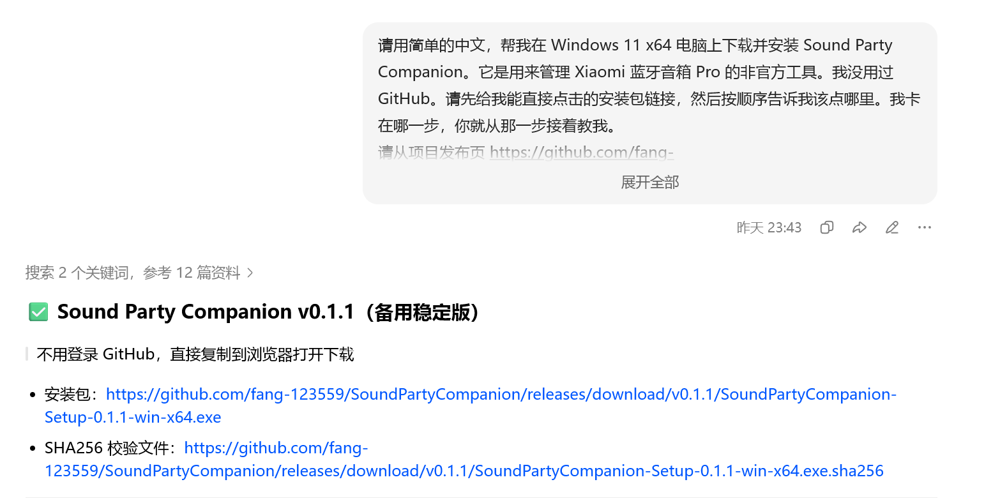
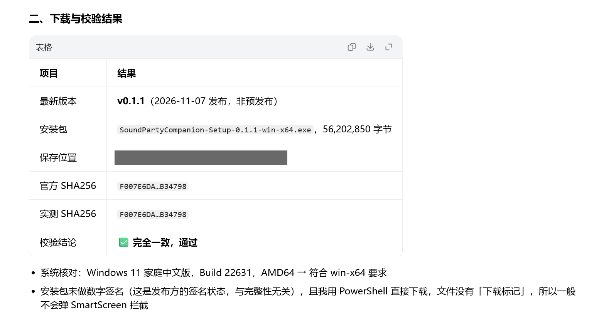
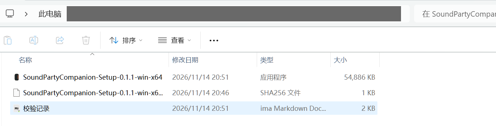

# Sound Party Companion-AI/Agent download

这个仓库帮助第一次使用 GitHub 的 Windows 11 x64 用户，通过 **AI 对话提示词**或 **Agent Skill** 获取 Sound Party Companion 安装包。[主项目 v0.1.1 发布页](https://github.com/fang-123559/SoundPartyCompanion/releases/tag/v0.1.1)提供安装包及同版 SHA256 校验文件。这里提供下载引导、完整性校验和安装排查步骤。

- **AI 助手提示词**：复制[提示词全文](./download-with-ai.txt)，发送给豆包或其他 AI 聊天助手，请它提供安装包直链并逐步指导下载。
- **Agent Skill**：将 [Skill ZIP](https://github.com/fang-123559/Sound-Party-Companion-AI-Agent-download/releases/latest/download/download-sound-party-companion.zip) 导入支持导入 Skill 的 Agent。具备本机下载权限的 Agent 可以代下载并校验文件，也可以提供链接和手动操作步骤。

**怎么选** · 普通 AI 聊天工具可以提供指定版本的直链和步骤。支持导入 Skill 且有本机下载权限的 Agent 还可以代下载并校验 SHA256。

下面用已实测的豆包对话和豆包工作演示这两种用法。

## 豆包对话

打开[豆包提示词](./download-with-ai.txt)，复制全文并发给豆包，同时明确指定 `v0.1.1`。按它给出的链接和步骤在 Windows 电脑上下载。

## 豆包工作

1. 下载 [Skill ZIP](https://github.com/fang-123559/Sound-Party-Companion-AI-Agent-download/releases/latest/download/download-sound-party-companion.zip)，把 ZIP 原文件上传到豆包工作。
2. 随附件发送下面这句话。

> 请从我上传的 ZIP 中导入并安装到项目级，同时启用 download-sound-party-companion 技能，帮我从 GitHub 下载 Sound Party Companion v0.1.1 的 Windows 11 x64 安装包，核对 SHA256，并一步步指导我安装。

可以直接查看 [SKILL.md](./download-sound-party-companion/SKILL.md)。

## 实测反馈

- ✅ **豆包对话（P3）**：发送提示词后，豆包给出了 `v0.1.1` 的 Windows x64 安装包和 SHA256 校验文件的 GitHub 直链。
- ✅ **豆包工作（P1–P2）**：导入 Skill 后，在 Windows 11 x64 上下载了 `v0.1.1` 安装包（56,202,850 字节）和校验文件。实测 SHA256 与项目发布值一致，资源管理器中也能看到下载的文件。

本次反馈验证到下载与 SHA256 校验，安装和启动结果待确认。

原项目与安装包发布页见 [Sound Party Companion](https://github.com/fang-123559/SoundPartyCompanion) 和 [v0.1.1 安装包发布页](https://github.com/fang-123559/SoundPartyCompanion/releases/tag/v0.1.1)。
